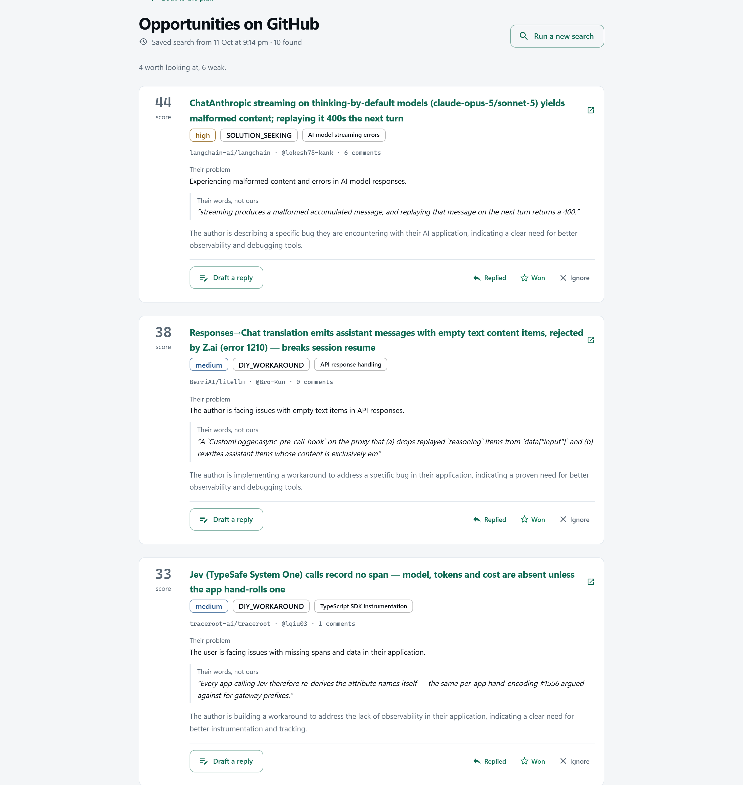
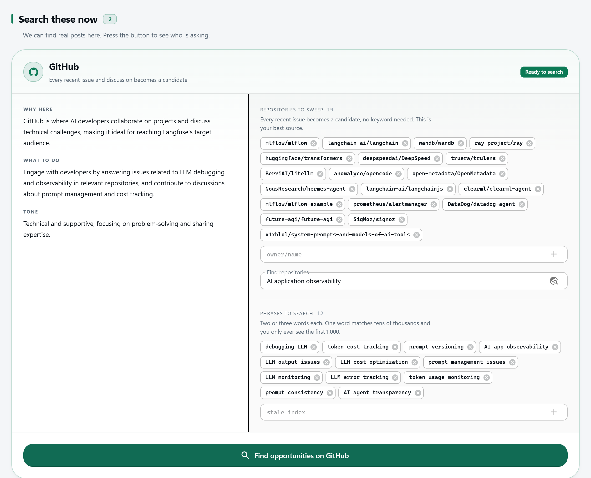
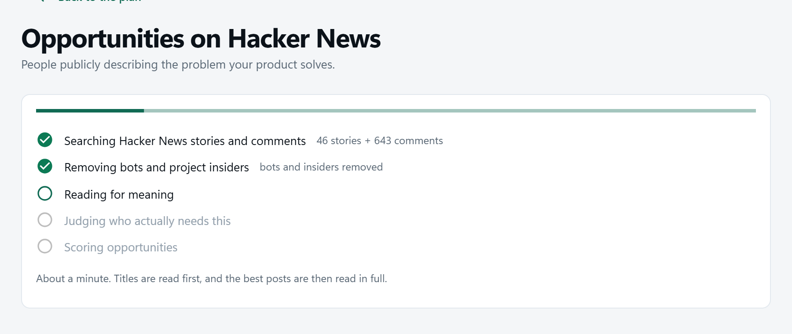
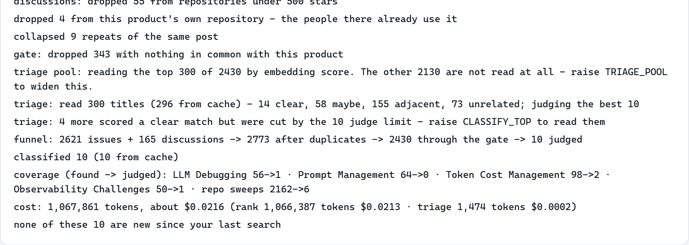

# Outreach

Finds public developer conversations where somebody describes a problem your
product solves, so you can reply helpfully. It searches **GitHub** (issues and
discussions) and **Hacker News** (stories and comments), ranks what it finds,
and explains every score.

It never posts anything. It drafts; a person edits and posts under their own name.



*A real search for a demo product ([Langfuse](https://langfuse.com), an
open-source LLM observability tool). More screenshots are [below](#screenshots).*

## Run it

Two terminals, PowerShell, from the repository root. PostgreSQL must be running;
the database and its tables are created on first startup.

**Terminal 1 — backend** (http://localhost:8000, API docs at `/docs`)

```powershell
cd backend
py -m venv .venv                                       # first time only
.venv\Scripts\python.exe -m pip install -e ".[dev]"    # first time only
copy .env.example .env                                 # first time only, then fill in the keys
.venv\Scripts\python.exe -m uvicorn outreach.main:app --reload
```

**Terminal 2 — frontend** (http://localhost:5173 — open this one)

```powershell
cd frontend
npm install                                            # first time only
npm run dev
```

`.env` needs `DATABASE_URL`, `OPENAI_API_KEY` (ranking and judging) and
`GITHUB_TOKEN` (raises GitHub search from 10 to 30 requests a minute). Setup
details, including installing PostgreSQL, are in [backend/README.md](backend/README.md).

### Tests, lint and build

```powershell
cd backend
.venv\Scripts\python.exe -m pytest -q                  # test suite
.venv\Scripts\python.exe -m ruff check src tests       # lint

cd ..\frontend
npm run build                                          # type-check and production build
```

### On Linux, macOS or WSL

The same steps with a different Python path. Needs Python 3.11 or newer.

```bash
docker compose up -d                 # optional: PostgreSQL in Docker, matches .env.example
                                     # (if port 5432 is taken, set POSTGRES_PORT and use it in DATABASE_URL)

cd backend
python3 -m venv .venv
.venv/bin/python -m pip install -e ".[dev]"
cp .env.example .env                 # then fill in the keys
.venv/bin/python -m uvicorn outreach.main:app --reload
```

---

## What it does

1. **You add a product**: a name and a website. Outreach reads the site once
   and writes a short profile of what the product does and which problems it solves.
2. **It writes a search plan**: phrases people use when they have that
   problem, and repositories where those people gather. You never type a
   keyword, though you can edit the plan.
3. **You press search** on GitHub or Hacker News. Hacker News takes under a
   minute and GitHub a few minutes. You get up to ten posts, best first, each
   with a score from 0 to 100.
4. **Every score opens up.** You see the author's own words that justify it,
   what they seem to want, and how the number was worked out.
5. **You reply yourself.** Outreach can draft a reply and keep track of the
   posts you answered, but posting is always done by a person.

### One real result

The top result of a real GitHub search for the demo product, an LLM
observability tool:

| | |
|---|---|
| **Post** | [ChatAnthropic streaming on thinking-by-default models yields malformed content; replaying it 400s the next turn](https://github.com/langchain-ai/langchain/issues/39687) |
| **Where** | `langchain-ai/langchain`, a GitHub issue with 6 comments |
| **Score** | **44** of 100 — band `high` |
| **What the author is doing** | `SOLUTION_SEEKING`: they have a problem and are asking how to solve it |
| **Their words** | "streaming produces a malformed accumulated message, and replaying that message on the next turn returns a 400." |
| **Why 44** | product fit 52% × intent 100% × 86% for reach, freshness and engagement |

The quote is checked against the post before it is stored. If the model
invents a quote, it is dropped.

---

## How a search works

The whole flow is in
[`backend/src/outreach/services/opportunity_service.py`](backend/src/outreach/services/opportunity_service.py).
Each step is cheaper than the one after it, so each one's job is to protect the next.

| # | Step | What happens | Uses a model? |
|---|---|---|---|
| 1 | **fetch** | GitHub keyword search (issues, plus discussions over GraphQL), or Algolia search for Hacker News (stories and comments) | no |
| 2 | **clean** | drops bots, small repositories, low-point stories, duplicates and posts from the product's own repository. Optionally also people posting in a repository they maintain | no |
| 3 | **gate** | drops posts that contain none of the plan's search words and none of a built-in list of domain words | no |
| 4 | **rank** | embeds every remaining post and sorts by similarity to the product | embeddings |
| 5 | **triage** | a cheap model reads **titles only**, 20 at a time, and scores each 0–3 | yes |
| 6 | **judge** | the best 10 posts are read in full: intent, fit, domain, and a quote | yes |
| 7 | **score** | plain arithmetic turns that into 0–100 | no |

Measured on one run of each, for one demo product, with an almost empty cache:

| | GitHub | Hacker News |
|---|---|---|
| Posts fetched | 2,786 | 942 |
| Posts left after the gate | 2,434 | 926 |
| Titles the triage reads | 300 | 300 |
| Posts the judge reads | 10 | 10 |
| Time | 2 min 57 s | 55 s |
| Cost | $0.032 | $0.014 |

The judge only reads posts whose title the triage scored 2 or more, so it
can read fewer than ten.

The triage used to read 25 titles on GitHub. Reading 300 was measured on the
same 2,434 posts: it found 4 results scoring 20 or more instead of 2, for
about half a cent extra. The best score did not go up.

### The score

```
score = 100 × match × intent × modifier
```

- **match** (0–1) mixes the embedding similarity with the judge's opinion of
  fit. The judge counts for more.
- **intent** (0–1) is what the author is doing. Asking for a solution is worth
  1.00; announcing their own project is worth 0.05.
- **modifier** (0.60–1.00) adjusts for reach (repository stars), freshness and
  engagement.

Match and intent **multiply**, so a post that fails either one scores near
zero however popular it is. Adding them up would let a popular, irrelevant
post reach the top of the page. The code is in
[`score.py`](backend/src/outreach/score.py), about 300 lines with the reasoning
written next to each number.

### Three decisions worth knowing

- **Titles before full posts.** Embedding similarity is nearly flat across the
  posts that matter, so "take the top ten by similarity" is close to random.
  Reading thousands of full posts is too expensive. Reading their titles is not.
- **The triage must answer for every title.** Asked about 40 titles, the model
  once answered about 9 and the other 31 silently got a default score. Now the
  batch is 20, the prompt states the count, missing answers are asked for once
  more, and a title skipped twice scores low.
- **Answers are cached.** A judgement is stored against the post's text, the
  product, the prompt version and the model. Searches overlap a lot, so most
  repeat work is free.

---

## What a run costs

Between one and three US cents. Every run ends with a line like these in its
notes, and the same totals in the server log. Both are from real runs:

```
GitHub       cost: 1,120,852 tokens, about $0.0315 (rank 1,067,341 tokens $0.0213 · triage 29,732 tokens $0.0060 · judge 23,779 tokens $0.0042)
Hacker News  cost: 237,735 tokens, about $0.0138 (rank 184,164 tokens $0.0037 · triage 31,342 tokens $0.0062 · judge 22,229 tokens $0.0039)
```

On GitHub two thirds of the cost is embedding about 2,500 posts. On Hacker
News the largest part is the triage reading 300 titles.

The token counts are exact, taken from what the API reports. The dollar figure
is an estimate from the price table in
[`usage.py`](backend/src/outreach/usage.py). Cached answers cost nothing and
add nothing, so a repeat search is cheaper.

---

## Measuring a change instead of eyeballing it

Prompt edits move result quality, and you cannot see by how much without
labels. The evaluation harness runs the triage and the judge over posts you
labelled by hand and prints how many each got right.

```bash
cd backend
python -m eval.label      # label posts: 0 not a lead, 1 maybe, 2 lead
python -m eval.run        # measure both stages against your labels
```

Details and how to read the output: [backend/eval/README.md](backend/eval/README.md).

---

## Repository layout

```
backend/     FastAPI service, tests, evaluation harness
frontend/    React + MUI (Material UI), built with Vite
scripts/     Two small command-line helpers
docs/        Screenshots
```

### Inside `backend/src/outreach/`

| Path | What it holds |
|---|---|
| `services/opportunity_service.py` | One search run, start to finish |
| `connectors/` | GitHub issues, GitHub discussions, Hacker News, and the website crawler |
| `classify.py` | The gate, the title triage and the judge |
| `rank.py` | Embeddings and similarity |
| `score.py` | The 0–100 score and its breakdown |
| `usage.py` | Token and cost counting |
| `planner.py`, `profile.py` | Turn a product website into a profile and a search plan |
| `reply.py`, `services/reply_*.py` | Draft a reply and check whether a tracked post got one |
| `llm/prompts/` | Every prompt, as a plain markdown file |
| `api/v1/` | HTTP endpoints |
| `db/` | SQLAlchemy models and repositories (Alembic migrations are in `backend/migrations/`) |

Stack: FastAPI, SQLAlchemy (async), PostgreSQL and Alembic on the backend;
React, MUI and Vite on the frontend; OpenAI for embeddings and classification.

---

## Sources

- **GitHub** and **Hacker News** are read through their official public APIs,
  inside their rate limits.
- **The system never posts.** It drafts a reply; a person edits it and posts
  it under their own name.

---

## Screenshots

All from the running app, with the demo product.

**The search plan.** Written from the product's website: where to look and
which phrases to search. Every chip can be edited before searching.



**A search in progress.**



**What the search actually did.** Every run explains itself: what was
dropped and why, the funnel, the coverage per problem, and the cost.



**The landing page.**


## License

[MIT](LICENSE)
